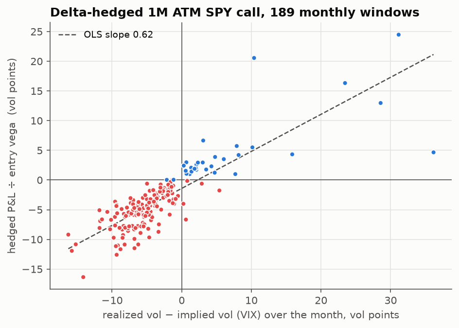
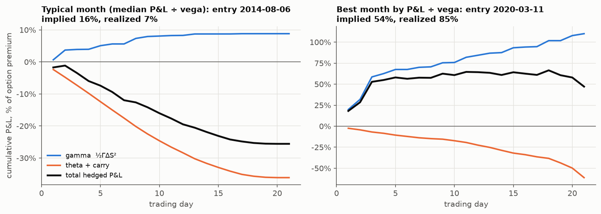
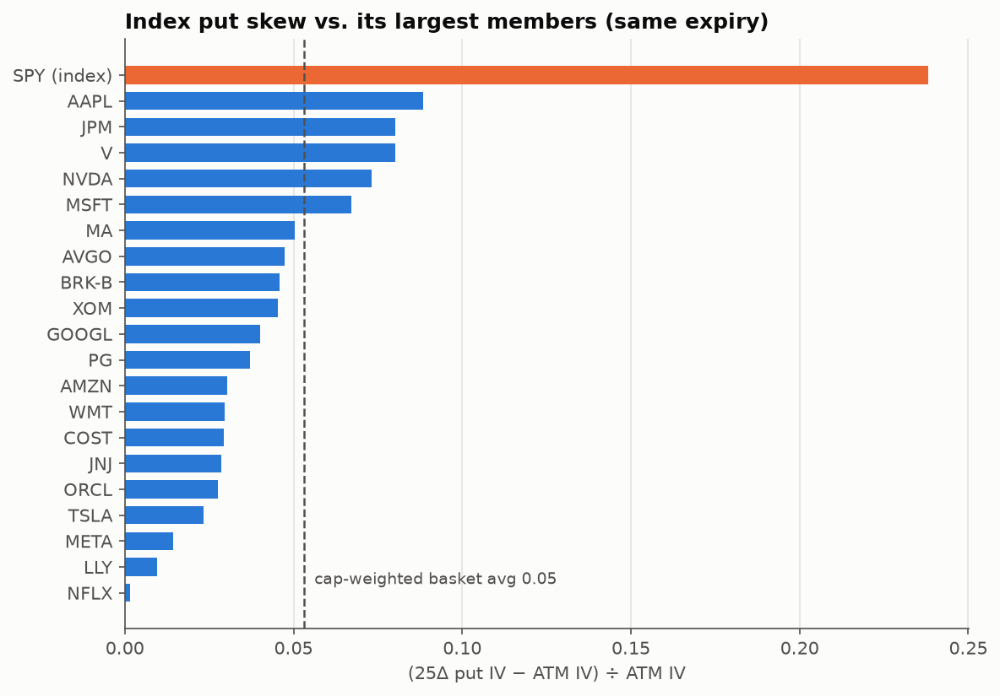
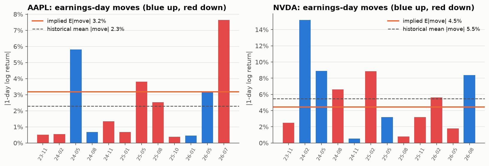
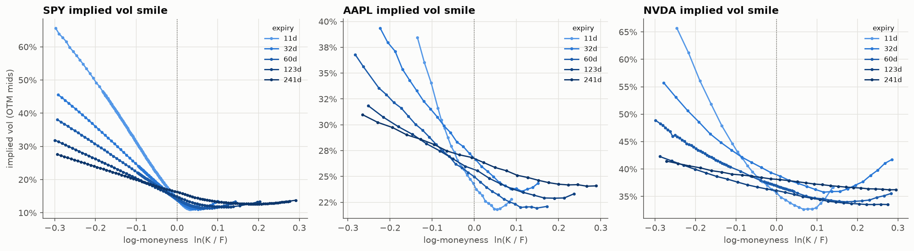
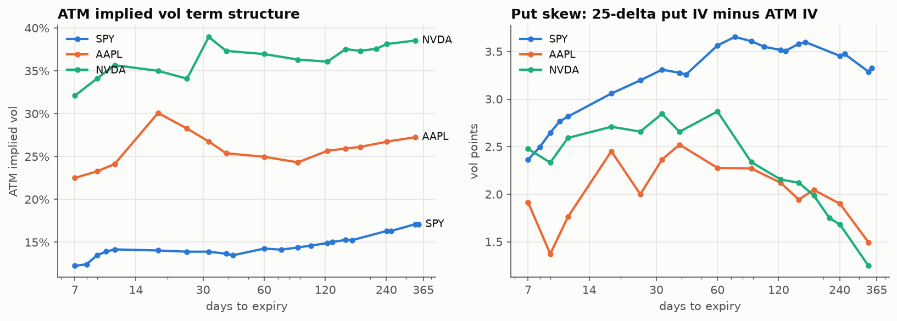
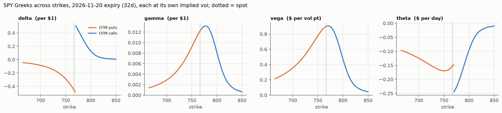

# Options Greeks & volatility: a hands-on study on real chains

A personal Python project that prices options with Black–Scholes–Merton,
backs implied volatility out of real market quotes, computes the Greeks, and uses them
to answer three volatility-trading questions:

1. **What do SPY, AAPL and NVDA vol surfaces look like today?** (smile, skew, term structure, earnings kinks)
2. **Why is a delta-hedged option a bet on realized vs. implied vol?** (15-year SPY backtest with gamma/theta P&L attribution)
3. **Why is index put skew so much steeper than single-stock skew?** (SPY vs. its 20 largest members; implied correlation)

Data: one end-of-day snapshot of Yahoo Finance option chains (**2026-10-19 close**),
plus daily SPY / VIX / 13-week T-bill history since 2010. Everything is cached under
`data/raw/2026-10-19/`, so every number below is reproducible offline.

## How to run

```bash
python3 -m venv .venv
```
```bash
.venv/bin/pip install -r requirements.txt
```
```bash
.venv/bin/python -m pytest -q
```
```bash
.venv/bin/python -m volproj.run_all
```

`run_all` reads the cached snapshot and writes tables to `output/` (per-contract IVs and
Greeks, per-expiry summaries, backtest windows, `summary.json`) and charts to `figures/`.
Add `--refresh` to download a new snapshot (free Yahoo data, no API key). A refresh on the
same trading day overwrites that day's folder. Tested with Python 3.12.

## Findings

### 1. A delta-hedged long option made money only when realized vol beat implied, and that happened in 18% of months

Setup: every 21 trading days from Jan 2011 to Oct 2026 (189 non-overlapping windows), buy a
1-month ATM SPY call priced at VIX, delta-hedge it daily at that same implied vol, and hold
it to expiry. Daily P&L is split into **gamma** (½ΓΔS², earned when the stock moves),
**theta** (time decay) and **carry** (financing the hedge plus dividends on the short stock).
The Black–Scholes PDE makes theta + carry ≈ −½σ²S²Γ·dt, so each day's hedged P&L is
≈ ½ΓS²·(r² − σ²_implied·dt): you win when the squared daily return beats the variance you paid for.
Dividends use the escrowed-dividend model: the option is priced on spot minus the PV of
the window's cash dividends, and those same dividends are paid on the short stock.

| | |
|---|---|
| Correlation of hedged P&L (in vol points of entry vega) with realized − implied vol | **0.84** |
| Windows where realized vol > VIX at entry | **18%** (34 / 189) |
| Windows with positive hedged P&L | **16%** (31 / 189) |
| Mean / median hedged P&L | **−20% / −24%** of option premium |
| Calendar years with a positive average | **0 of 16** |
| Best window (% of premium) | +205% (entry 2018-01-08: implied 9.5%, realized 20%, "Volmageddon") |
| Gamma + theta + carry vs. actual P&L | residual averages 3% of premium (discrete hedging, higher-order terms) |




The right panel (the best window measured in vol points, P&L ÷ entry vega) shows the path
dependence: in March 2020 realized vol (85%) beat implied
(54%) by far, but as SPY fell away from the strike the call's gamma shrank, so most of the
gain came in the first three days. A variance swap removes this path dependence; an
option does not.

**Caveat about what "implied" means here.** Free historical SPY option prices are not
available, so the backtest uses VIX as implied vol. VIX is a variance-swap-style number that
includes the out-of-the-money put wing. On the snapshot date, a simplified replication of the
CBOE VIX formula on SPY options (SPY rather than SPX, no strike-truncation rules) gives
**18.4, within ~0.5 pt of the published 18.44**. The per-expiry values range from 17.6 to
18.6 depending on how far each expiry's strikes reach. SPY's 30-day ATM IV is **13.9**, so
roughly 4–5 points of VIX come from the wings. In the backtest, implied would need to be
about 3 points below VIX for the long-option strategy to roughly break even (mean −2.1% of
premium at VIX − 3, +6.5% at VIX − 4). So the robust conclusion is that **buying 1M SPY vol at
variance-swap levels lost money consistently**. Whether *ATM* options alone were overpriced
by the same amount can't be measured with this data.

### 2. Relative to ATM vol, SPY's put skew is ~4.5× steeper than its largest members', and implied correlation roughly doubles on the downside

For the 2026-11-20 expiry (32 days), 25-delta-put IV minus ATM IV:

| | ATM IV | 25Δ put − ATM | as % of ATM |
|---|---|---|---|
| SPY | 13.9% | 3.3 vol pts | **24%** |
| 20 largest S&P names (cap-weighted avg) | 33.9% | 1.7 vol pts | **5.3%** |

In raw vol points SPY's skew is about 2× the basket's (3.3 vs 1.7). Scaled by ATM vol it is
about 4.5× (24% vs 5.3%), and all 20 names are flatter than SPY on that measure. Plugging
ATM vols into the implied-correlation formula gives ρ ≈ **0.08**. Plugging 25-delta-put
vols gives ρ ≈ **0.15** (60-day expiry: 0.11 → 0.20). An index is only as volatile as its
constituents are correlated, and the market prices correlation rising in a sell-off.
Persistent demand for index puts as portfolio protection (hedging flows that are forced,
not views) is what that skew charges for. Single-stock puts carry much less of it, and that
gap is what dispersion and correlation trades target.

One more caveat on the downside number: a 25-delta put is further out of the money for a
high-vol stock. At 32 days, SPY's sits at ln(K/F) = −3.3% and the basket's cap-weighted
average at −6.6%, so the "downside" correlation compares slightly different scenarios. It
illustrates the effect rather than measuring a fixed-move correlation.



Read the *levels* with care. A 20-name basket is not the 500-name index: SPY is more
diversified than the basket, which biases the formula's ρ down. On realized data (last 63
days) the same formula gives 0.01, while the direct cap-weighted pairwise correlation is
0.07. Also, most of these names report earnings before Nov 20, which inflates their ATM vols
and pushes implied correlation down further. The *ATM → downside* increase and the skew gap
are much less sensitive to these biases than the levels are.

### 3. Option prices imply a 3.2% AAPL earnings move vs. a 2.3% historical average; NVDA's 4.5% is below its 5.5% average

Both term structures have a kink at the first expiry after earnings (AAPL: 24.1% → 30.1%
between Oct 30 and Nov 6; NVDA: 34.1% → 39.0% between Nov 13 and Nov 20). Treating the
extra total variance as a one-day event move:

| | Next report (Yahoo estimate) | Implied event std | Implied E\|move\| | Last 12 actual: mean / median \|move\| | Share of last 12 above implied |
|---|---|---|---|---|---|
| AAPL | 2026-11-02 | 4.0% | **3.2%** | 2.3% / 1.0% | 4 / 12 |
| NVDA | 2026-11-17 | 5.6% | **4.5%** | 5.5% / 4.4% | 6 / 12 |



On these numbers AAPL's event is priced above its history (fat-tailed, though: its two
largest moves were 5.8% and 7.6%), while NVDA's is priced near its median and below its
mean. That makes this a starting point for a fundamental view on the upcoming print, not a
trade signal. The method assumes the non-event vol stays at the pre-event level and counts
calendar days, and 12 observations is a small sample.

### Surface snapshot (2026-10-19)




- SPY ATM IV: 13.9% (30d), 14.4% (90d), 15.6% (180d), with an upward-sloping term structure.
  The smile is a steep put-side skew with almost no call wing.
- AAPL / NVDA ATM IV: 27% / 38% (30d). Their short-dated smiles turn up on the call side
  (upside gap risk around earnings). SPY's call wing is nearly flat.
- Short-dated single-stock skew is distorted by earnings, while SPY's 25-delta skew
  deepens out to ~60–90 days.



At a given strike, the put/call theta jump at spot is the rate term (−rKe^{−rT}N(d₂) for
calls vs. +rKe^{−rT}N(−d₂) for puts) plus the different IVs on each side. It is not a bug.

## Method

| Step | Implementation | Code |
|---|---|---|
| Pricing | Black–Scholes–Merton with continuous dividend yield q | `volproj/bs.py` |
| Greeks | Closed-form delta, gamma, vega, theta, rho; desk units via `scale_greeks` | `volproj/bs.py` |
| Implied vol | No-arbitrage bounds check, then Brent on [1e-4, 5] (bracket widened up to 20); safeguarded Newton-on-vega fallback from the Brenner–Subrahmanyam guess | `volproj/iv.py` |
| Rates | Flat continuously-compounded rate from the 13-week T-bill discount yield: r = −ln(1 − d·91/360)·365/91 = 4.15% | `volproj/data.py` |
| Dividends / forward | Default: per-expiry forward from near-ATM put-call parity, turned into an implied carry q. Alternative (`forward="div"`): trailing-12m dividend yield. The trailing yield gets SPY's forward wrong for two reasons: dividends arrive quarterly rather than evenly (no ex-date before the Dec 18 expiry), and the 4:00pm stock close is slightly stale against the 4:15pm option close. Using it, same-strike call and put IVs near the money disagree by a median 0.98 vol pts on SPY. The parity forward brings that to 0.02, which is a consistency check, not independent validation, since the forward is fitted to those same quotes. | `volproj/surface.py` |
| Quote filter | OTM only (BS ignores the early-exercise premium of these American options; it is small OTM), bid > 0, mid ≥ $0.05, relative spread ≤ 30%, \|ln K/F\| ≤ 0.5, ≥ 7 days | `volproj/surface.py` |
| Skew metrics | ATM IV interpolated at k = 0; 25-delta IVs interpolated on each contract's own BS delta | `volproj/surface.py` |
| VIX check | CBOE model-free variance formula on SPY OTM mids, interpolated to 30 days | `surface.model_free_vol` |
| Hedge backtest | Daily re-hedge at implied vol, mark at implied, cash at r. Escrowed dividends: the option is priced on S − PV(window dividends), and the same cash dividends are paid on the short. Each window's actual SPY dividends are treated as known at entry, since ex-dates are scheduled and amounts predictable. | `volproj/hedge.py` |
| Implied correlation | ρ = (σ²_I − Σw²σ²) / ((Σwσ)² − Σw²σ²), market-cap weights renormalized within the basket | `volproj/corr.py` |
| Earnings | Event variance = w(T₂) − σ₁²·T₂ across the expiries bracketing the report | `volproj/events.py` |

**Tests** (`tests/`, 1,143 pass, 80 skipped by design):
- *Pricing and IV:* a textbook (Hull) price check; put-call parity across a 240-case grid;
  all five Greeks vs. central finite differences for calls and puts; IV round-trip; Newton
  agrees with Brent, and "auto" falls back to Newton when Brent fails; arbitrage-violating
  prices are rejected.
- *Hedge backtest:* the cash flows net to ~0 on a riskless deterministic path with rates and
  a cash dividend. Flipping the sign of the financing or dividend line fails this test,
  checked by mutation. Hedged P&L is unbiased when realized = implied with r > 0 and
  dividends, and its sign follows realized vs. implied on simulated paths. The
  theta + carry = −½σ²S²Γ identity also holds.
- *Surface:* it recovers a known smile, its 25-delta IV and moneyness, and the true carry
  from a synthetic chain fed the wrong dividend yield. Total-variance interpolation is
  checked.
- *Other:* the VIX formula returns 20% on a flat 20% chain; the implied-correlation formula
  recovers a known ρ; earnings reaction days map correctly for after-close and pre-open
  reports, including an expiry on the report date.

The 80 skips are IV round-trips at prices indistinguishable from the no-arbitrage bound,
where vol is not identifiable.

**Sanity checks** (in `output/summary.json`): every used quote reprices to its mid within
1e-8. All 4,182 SPY/AAPL/NVDA IVs converged with Brent, so the Newton fallback (which is
tested separately) was not needed on this snapshot. The median absolute difference from Yahoo's own `impliedVolatility` field is
1.0–1.5 vol pts. Yahoo's field runs about 1 pt below mine on puts and 1–2 pts above on
calls, which is consistent with a different forward and is why it isn't used.

## Limitations

- One snapshot, end-of-day Yahoo quotes: free but not exchange-grade. Wide or stale quotes are filtered, not fixed.
- European BS on American options: fine OTM, wrong for deep ITM (which is excluded).
- Flat rate curve. In the backtest, each window's actual dividends are assumed known at entry.
- Backtest uses VIX, not traded SPY ATM IV, as implied (see Finding 1), and ignores transaction costs.
- Implied correlation uses 20 names rather than the full index, in earnings season.

## Layout

```
volproj/
  data.py      download + cache (yfinance), Snapshot loader
  bs.py        Black–Scholes–Merton prices and Greeks
  iv.py        implied vol: bounds check, Brent, Newton fallback
  surface.py   quote cleaning, parity forwards, IV/Greeks per contract, ATM/25Δ summaries, VIX replication
  hedge.py     delta-hedged option simulator and rolling backtest
  corr.py      implied and realized correlation
  events.py    implied vs. realized earnings moves
  plots.py     figures
  run_all.py   pipeline
tests/         pricing, IV and analytics tests
data/raw/      cached snapshot (chains, meta, histories)
output/        generated tables     figures/  generated charts
```
